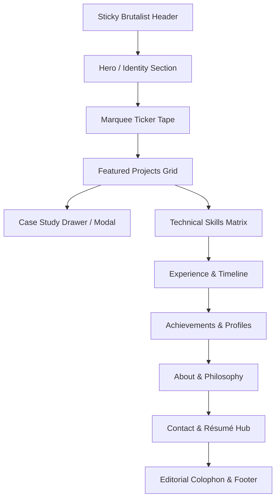

# Product Requirements Document (PRD)
## Project: Kalendra Yadav — Personal Developer Portfolio

**Version**: 1.0.0  
**Phase**: Phase 1 — Specification & Architecture  
**Status**: Implementation-Ready  
**Author**: Antigravity Technical Architecture & Design Systems Team  
**Last Updated**: October 2026  

---

## 1. Executive Summary & Product Vision

### 1.1 Vision Statement
To build an exceptionally polished, distinctive, and responsive personal developer portfolio for **Kalendra Yadav** that establishes an authoritative professional identity. The portfolio merges **Neo-Brutalism** (bold structure, black borders, hard drop shadows, cyber yellow surfaces) with **Pop Art** (halftone screenprint textures, red-and-blue duotone portraits, punchy sticker labels) and **Interactive Editorial Storytelling** (newspaper-style layout, architecture breakdowns, digestible case studies).

### 1.2 Core Philosophy
- **Punchy yet Professional**: Memorable visual impact that commands attention without feeling childish or chaotic.
- **Truthful & Verified**: Absolute integrity in all claims, metrics, and project statuses. No fabricated numbers, empty demo buttons, or exaggerated titles.
- **Static-First & Ultra-Performant**: Zero database overhead, instant page loads (<1s), zero cumulative layout shift (CLS = 0), and seamless mobile responsiveness.
- **Accessible & Usable**: WCAG 2.2 AA compliant. Visual boldness must amplify—never compromise—readability and navigation.

---

## 2. Target Audiences & User Journeys

### 2.1 Audience Personas

| Persona | Primary Goal | Time Spent | Key Information Needed |
| :--- | :--- | :--- | :--- |
| **Technical Recruiter / Talent Acquisition** | Rapidly assess candidate viability against job specs. | 30–60 seconds | Current role/positioning, core tech stack, résumé download, GitHub/LinkedIn links, contact email. |
| **Engineering Manager** | Evaluate architectural thinking, code quality, and technical maturity. | 2–5 minutes | Engineering showcase, project problem statements, architectural tradeoffs, repository code structure. |
| **Technical Interviewer / Senior Peer** | Review problem-solving depth, systems design intuition, and computer science fundamentals. | 3–10 minutes | Live demos, data structures & algorithms profile (LeetCode/Codeforces), technical case studies, lessons learned. |
| **Startup Founder / Collaborator** | Gauge velocity, product sense, ability to ship end-to-end, and visual taste. | 1–3 minutes | Full-stack projects, UI polish, initiative, ownership, direct contact mechanism. |

### 2.2 Critical User Journeys

#### Journey 1: The 30-Second Recruiter Scan
1. **Landing**: Enters Hero section. Immediately absorbs developer name, clear positioning title (*"Full-Stack Software Engineer"*), and location.
2. **Action**: Clicks primary action button: **[Download Résumé]** or jumps to **[View Projects]**.
3. **Validation**: Quickly scans the sticky navigation bar or Hero quick-links to open verified GitHub and LinkedIn profiles.
4. **Outcome**: Successfully downloads résumé and copies contact email in under 30 seconds.

#### Journey 2: The Deep-Dive Engineering Evaluation
1. **Discovery**: Reads project cards in the **Featured Projects** grid. Filters by tag (e.g., *Full-Stack*, *AI/Systems*).
2. **Deep-Dive**: Clicks on a project to open the **Technical Case Study Modal / Drawer**.
3. **Analysis**: Inspects the problem statement, system architecture diagram, key technical challenges overcome, and stack decisions.
4. **Code Inspection**: Clicks the **[View Source Code]** link to inspect the clean GitHub repository.
5. **Outcome**: Verifies candidate builds real, thoughtfully architected software with strong technical grounding.

#### Journey 3: The Direct Outreach Flow
1. **Navigation**: Clicks `Contact` in sticky header or scrolls to footer.
2. **Action**: Clicks the **[Copy Email]** button (instant visual confirmation: *"Copied to Clipboard!"* with haptic/tactile button feedback).
3. **Alternative**: Uses one-click direct `mailto:` link with pre-filled subject line.

---

## 3. Goals and Non-Goals

### 3.1 Product Goals
- Establish Kalendra Yadav as a high-caliber software engineer with strong fundamentals and modern frontend/full-stack proficiency.
- Achieve a visual presentation that stands out among standard cookie-cutter portfolio templates.
- Maintain top-tier web performance: 90+ across all Lighthouse audits (Performance, Accessibility, Best Practices, SEO).
- Provide a modular, maintainable TypeScript codebase that Kalendra can easily update with new projects and achievements.

### 3.2 Non-Goals (Scope Boundaries)
- **No Database / Authentication**: No user login, no admin dashboard, and no database infrastructure. Content is driven by typed static files.
- **No Custom CMS**: No Strapi, Sanity, or WordPress integration for initial release.
- **No Heavy 3D / WebGL Runtimes**: No Three.js or heavy Canvas simulations that drain mobile batteries or compromise load performance.
- **No Unverified Claims**: No vanity metrics, fictitious company logos, or placeholder testimonials.

---

## 4. Information Architecture & Page Structure

The application follows a **Static-First, Single-Page Editorial Flow** with sticky navigation and accessible anchor links, augmented by interactive slide-out/modal deep-dives for project case studies.



### Section Breakdown & Specifications

#### 1. Sticky Brutalist Header
- **Purpose**: Global orientation and instantaneous access to critical actions.
- **Components**:
  - Logo/Name Badge: `KALENDRA.DEV` with black border and hover offset.
  - Quick Links: `#projects`, `#skills`, `#experience`, `#about`, `#contact`.
  - Primary CTA: `[RÉSUMÉ]` button (high-contrast yellow/black, tactile click).
  - Mobile Menu Toggle: Neo-brutalist burger button opening full-screen tactile overlay.
- **Acceptance Criteria**: Sticky on scroll, stays within WCAG contrast limits, dismisses mobile menu on item selection or Escape key press.

#### 2. Hero Section (The Hook)
- **Purpose**: Create unforgettable first impression in under 3 seconds.
- **Components**:
  - Eyebrow Badge: `[STATUS: OPEN FOR ROLES / COLLABORATION]` with glowing green pulse dot.
  - Headline: Massive editorial typography (`SPACE GROTESK`, UPPERCASE, bold outlines).
  - Subtitle: Clear, punchy description of Kalendra's engineering focus.
  - Pop-Art Portrait Frame: Red-and-blue duotone screenprint portrait with halftone dot backing and offset brutalist card frame.
  - Dual CTAs: `[EXPLORE PROJECTS ➔]` (Primary Yellow) and `[GET IN TOUCH]` (Clean White).
  - Social Pill Strip: GitHub, LinkedIn, DSA icons with hard shadows.

#### 3. Infinite Marquee Ticker
- **Purpose**: Dynamic visual separation signaling forward momentum and technical energy.
- **Components**:
  - Continuous running track with bold text: `FULL-STACK // SYSTEMS // NEXT.JS // TYPESCRIPT // PERFORMANCE // ARCHITECTURE //`.
  - Black background with cyber yellow text, bordered top and bottom with 3px solid black lines.
  - Pauses on hover/focus and respects `prefers-reduced-motion`.

#### 4. Featured Projects & Technical Case Studies
- **Purpose**: Present engineering capabilities through concrete, verifiable project work.
- **Layout**: 2-column or 3-column responsive card grid.
- **Card Anatomy**:
  - Top Bar: Retro window pills (`[● ■ ✕]`) or status sticker (`[PRODUCTION]`, `[OPEN SOURCE]`, `[PROTOTYPE]`).
  - Project Preview: High-contrast screenshot or stylized editorial diagram framed in black border.
  - Title & One-line Pitch: High-legibility display font.
  - Problem Solved: 2-sentence summary of the user problem and engineering challenge.
  - Tech Stack Badges: Individual pill tags (e.g., `React`, `Node.js`, `PostgreSQL`, `Tailwind`).
  - Action Controls:
    - `[View Case Study]` button (opens detailed architectural breakdown).
    - `[GitHub Repo]` link (with external link icon; hidden if private/unconfirmed).
    - `[Live Demo]` link (hidden if unverified).
- **Candidate Projects Under Evaluation**:
  1. *BioTrace / NidusClean*
  2. *NetraVaha*
  3. *Nexa*
  4. *VyomCare*
  5. *Automate.com*

#### 5. Technical Skills Matrix
- **Purpose**: Demonstrate breadth and depth across engineering domains without meaningless percentage bars.
- **Organization**: Categorized grouping:
  - **Languages**: TypeScript, JavaScript, Python, C/C++, SQL, HTML/CSS.
  - **Frontend & UI**: Next.js, React, Tailwind CSS, Responsive Design, State Management.
  - **Backend & Systems**: Node.js, Express, REST APIs, GraphQL, Database Design.
  - **Tools & DevOps**: Git, GitHub, Docker, Linux, CI/CD basics, Vercel.
  - **Core Computer Science**: Data Structures & Algorithms, Object-Oriented Design, System Design Fundamentals.
- **Visual Style**: Neo-brutalist pill grid with tactile hover lift.

#### 6. Experience & Practical Exposure Timeline
- **Purpose**: Present internships, team projects, hackathons, and open-source contributions.
- **Layout**: High-contrast vertical timeline with solid black line and square node markers.
- **Card Content**: Role/Title, Organization/Context, Date Range, Bulleted technical achievements.

#### 7. Achievements & Coding Profiles
- **Purpose**: Provide objective proof of problem-solving ability.
- **Components**:
  - DSA & Competitive Programming Cards: LeetCode / Codeforces / HackerRank profile link cards with verified problem counts or contest ratings (once confirmed).
  - Hackathon & Academic Milestones: Structured accolade cards.

#### 8. About & Engineering Philosophy
- **Purpose**: Humanize Kalendra, convey communication clarity, work ethics, and passion for craftsmanship.
- **Components**:
  - Editorial bio written in crisp, professional first-person.
  - "How I Work" principle cards (e.g., *Code Quality over Clever Hacks*, *User-Centric Architecture*, *Continuous Learning*).
  - Secondary Pop-Art Portrait or candid editorial workspace frame.

#### 9. Contact & Résumé Hub
- **Purpose**: Convert interested visitors into real conversations.
- **Components**:
  - Large callout card with yellow backing and hard shadow.
  - Primary Contact Action: `[COPY EMAIL ADDRESS]` with active copy-to-clipboard state.
  - Direct Link: `[OPEN IN EMAIL CLIENT]` (`mailto:`).
  - Résumé Action: `[DOWNLOAD OFFICIAL CV (PDF)]` with file size and date updated.
  - Direct Social Badges: GitHub, LinkedIn, X/Twitter.

#### 10. Colophon & Footer
- **Purpose**: Professional wrap-up, copyright, and subtle technical credits.
- **Content**: Built with Next.js, Tailwind CSS, Motion. © 2026 Kalendra Yadav. All rights reserved.

---

## 5. Personal Brand & Content Policy

### 5.1 Primary Brand Positioning
**Kalendra Yadav — Full-Stack Software Engineer**  
*Focus*: Crafting resilient web applications, elegant frontend systems, and high-performance digital products with relentless attention to architectural clarity.

### 5.2 Strict Content Truth Policy
1. **Zero Fabrication**: No fictitious metrics, imaginary active user counts, fake client logos, or false claims of production traffic.
2. **Graceful Degradation for Missing Links**:
   - If a project repository is not publicly available or confirmed, the `[GitHub]` button is omitted entirely.
   - If a live deployment is offline or not verified, the `[Live Demo]` button is omitted.
   - Under no circumstances will disabled, broken, or dummy `href="#"` buttons be displayed to visitors.
3. **Transparent Status Badges**: Each project clearly displays its verified development status:
   - `[RELEASED / LIVE]` — Publicly accessible and verified.
   - `[OPEN SOURCE]` — Public code repository available for inspection.
   - `[CASE STUDY]` — Architectural/academic project with documented design decisions.
   - `[IN ACTIVE DEVELOPMENT]` — Work in progress with genuine roadmap.

---

## 6. Pop-Art Portrait System Architecture

### 6.1 Artistic Direction
Inspired by Pop Art masters and comic screenprint techniques (Reference Images 2, 3, 5):
- **Duotone Palette**: Rich ink black (`#0A0A0A`) shadows, deep cobalt blue (`#0047FF`) midtones, and punchy pop red (`#FF3333`) highlights.
- **Halftone Texture**: Distinct dot raster pattern simulating print mechanical reproduction.
- **Framing**: Clean rectangular neo-brutalist container with a `3px` solid black border, offset backing card in cyber cyan (`#00E5FF`) or pop pink (`#FF2A85`), and a hard drop shadow (`shadow-[6px_6px_0px_#000]`).

### 6.2 Implementation Strategy: Pre-Generated Static Graphics
- **Architecture**: Pre-generate optimized static image assets (WebP/AVIF) processed via duotone and halftone rasterization, rather than relying on heavy client-side canvas shaders or complex CSS filter chains that may fail or degrade battery life on mobile browsers.
- **Layering System**:
  1. Base: Solid colored background card (Cyan/Yellow).
  2. Middle: Optimized duotone pop-art portrait with transparent/cutout backdrop.
  3. Overlay (optional): SVG-based halftone dot matrix pattern overlay via CSS mask.
  4. Top: Thick black frame with graphic corner accents and status tape label (`// DEV_ID: KY-01`).
- **Placeholder Strategy for Development**: High-contrast, stylized vector portrait adhering to the exact color tokens until Kalendra's final reference photograph is provided.

---

## 7. Interaction & Motion Specification

All animations are designed to provide **tactile, physical feedback** (like real-world push buttons and printed paper cutouts) without unnecessary slowness or dizzying parallax.

### 7.1 Motion Rules

| Interaction | Trigger | Animation Behavior | Duration / Curve | Fallback / Reduced Motion |
| :--- | :--- | :--- | :--- | :--- |
| **Brutalist Button Press** | `:hover` & `:active` | On hover: lifts up & left by `2px`, shadow deepens from `4px` to `6px`. On active (click): snaps down & right by `2px`, shadow shrinks to `0px`. | `100ms ease-out` | Static border highlight, no positional movement. |
| **Card Hover Lift** | `:hover` | Card translates `-3px, -3px`, shadow extends from `4px` to `7px`. | `150ms cubic-bezier(0.16, 1, 0.3, 1)` | Color highlight, no translation. |
| **Section Reveal** | Scroll into viewport | Content fades from `opacity: 0, y: 16px` to `opacity: 1, y: 0px`. Staggered children (`50ms` delay). | `300ms ease-out`, triggers once (`once: true`). | Instant visibility (`opacity: 1, y: 0`). |
| **Marquee Banner** | Automatic loop | Continuous horizontal translation (`x: 0%` to `x: -50%`). Pauses on `:hover` or `:focus`. | `25s linear infinite` | Static wrap list, zero continuous scroll. |
| **Copy Email Feedback** | Click | Button icon switches from Clipboard to Checkmark, text changes to *"COPIED!"*, pops scale `1.05` then resets after 2s. | `150ms` snap | Standard text swap without scale pop. |
| **Modal / Drawer Open** | Click Project Card | Backdrop fades in (`opacity: 0` to `0.6`). Modal snaps in with slight scale `0.98` to `1.0`. | `200ms ease-out` | Instant appear without zoom. |

### 7.2 Animation Performance Rules
- Exclusively animate GPU-accelerated properties: `transform` and `opacity`.
- Zero animation on layout triggers (`width`, `height`, `margin`, `padding`).
- Implement `motion-reduce:transform-none` and `useReducedMotion()` hooks across all interactive components.

---

## 8. Technical Architecture

### 8.1 Stack Selection & Rationale
- **Framework**: **Next.js 14/15 (App Router)**. Provides static site generation (SSG) for instant TTFB, native font optimization (`next/font`), and automatic asset optimization.
- **Language**: **TypeScript (Strict Mode)**. Guarantees type safety for all project schemas, navigation items, and external URLs.
- **Styling**: **Tailwind CSS**. Custom-configured design tokens for neo-brutalist border widths, hard drop shadows, and high-contrast color variables.
- **Icons**: **Lucide React**. Clean, tree-shakable SVG icon set configured with uniform stroke width (`strokeWidth={2.5}` to match brutalist lines).
- **Motion**: **Motion for React (`framer-motion`)**. Industry standard for robust, accessible micro-interactions.
- **Package Manager**: **npm** (verified working natively in user's environment).

### 8.2 Directory Architecture

```
d:/web project/portfolio/
├── docs/
│   ├── PRD.md
│   ├── DESIGN_SYSTEM.md
│   └── CONTENT_INVENTORY.md
├── PROJECT_STATUS.md
├── public/
│   ├── images/
│   │   ├── portraits/
│   │   └── projects/
│   ├── documents/
│   │   └── kalendra-yadav-resume.pdf
│   ├── favicon.ico
│   └── og-image.png
└── src/
    ├── app/
    │   ├── layout.tsx
    │   ├── page.tsx
    │   ├── globals.css
    │   ├── robots.ts
    │   └── sitemap.ts
    ├── components/
    │   ├── ui/               # Atomic brutalist primitives
    │   │   ├── Button.tsx
    │   │   ├── Card.tsx
    │   │   ├── Badge.tsx
    │   │   ├── SectionHeading.tsx
    │   │   └── Marquee.tsx
    │   ├── layout/           # Global shell
    │   │   ├── Navbar.tsx
    │   │   ├── MobileNav.tsx
    │   │   └── Footer.tsx
    │   ├── sections/         # Main page sections
    │   │   ├── HeroSection.tsx
    │   │   ├── ProjectsSection.tsx
    │   │   ├── SkillsSection.tsx
    │   │   ├── ExperienceSection.tsx
    │   │   ├── AchievementsSection.tsx
    │   │   ├── AboutSection.tsx
    │   │   └── ContactSection.tsx
    │   └── modals/           # Interactive deep-dives
    │       └── CaseStudyModal.tsx
    ├── data/                 # Strongly-typed static content
    │   ├── projects.ts
    │   ├── skills.ts
    │   ├── experience.ts
    │   ├── achievements.ts
    │   └── profile.ts
    ├── types/                # TypeScript schemas
    │   ├── project.ts
    │   ├── skill.ts
    │   └── profile.ts
    └── lib/                  # Helper utilities
        └── utils.ts
```

### 8.3 Server vs. Client Component Strategy
To maximize performance and keep JavaScript bundles minimal:
- **Server Components (Default)**: Layout, static typography wrappers, initial HTML document, data definitions, and SEO tags.
- **Client Components (`'use client'`)**: Only interactive leaves:
  - `Navbar.tsx` (mobile toggle state, active scroll highlight).
  - `Marquee.tsx` (pause/play controls).
  - `CaseStudyModal.tsx` (open/close dialog state).
  - `CopyButton.tsx` (clipboard API).
  - Animated cards utilizing `motion.div`.

---

## 9. Contact & External Integrations

### 9.1 Phase 1–8 Baseline (Zero Backend Dependency)
- **Direct Email Copy**: High-contrast brutalist button using `navigator.clipboard.writeText('contact@example.com')` with visual confirmation.
- **Fallback Mailto**: Direct `<a href="mailto:contact@example.com?subject=Inquiry%20via%20Portfolio">`.
- **Direct PDF Download**: `<a href="/documents/kalendra-yadav-resume.pdf" download="Kalendra_Yadav_Resume.pdf">`.
- **Social Outbound Links**: Standard `target="_blank" rel="noopener noreferrer"` links with clear descriptive `aria-label` tags.

### 9.2 Optional Phase 8 Enhancement (Form Submission)
If a live contact form is desired:
- Utilize a secure, zero-backend third-party service (e.g., Formspree or Resend serverless route).
- Form inputs validated client-side with native HTML5 constraints + Zod schema.
- Anti-spam honeypot field.
- **Never expose private API keys in client-side code.** If an API key is required, use Next.js Route Handlers (`src/app/api/contact/route.ts`) with environment variables protected in `.env.local` (and strictly excluded from Git).

---

## 10. Accessibility (WCAG 2.2 AA)

- **Color Contrast**:
  - Yellow background (`#FFE600`) with Black text (`#0A0A0A`): **15.3:1** (Exceeds WCAG AAA requirement of 7:1).
  - White background (`#FFFFFF`) with Black text (`#0A0A0A`): **19.8:1** (Exceeds WCAG AAA).
  - Accent colors (Cyan, Magenta, Lime) are strictly paired with black text for small labels.
- **Keyboard Navigation**:
  - Full keyboard accessibility: every interactive element is reachable via `Tab` and activatable via `Enter` or `Space`.
  - Visible focus indicators: 3px solid outline with 2px offset (`focus-visible:outline-3 focus-visible:outline-black focus-visible:outline-offset-2`).
  - Skip to main content link: `<a href="#main-content" className="sr-only focus:not-sr-only ...">Skip to content</a>`.
- **Screen Reader Support**:
  - Proper heading hierarchy (`h1` for hero, `h2` for section titles, `h3` for project/card titles).
  - Meaningful `alt` attributes for all images.
  - Decorative icons and stars marked with `aria-hidden="true"`.

---

## 11. Performance & SEO

### 11.1 Performance Targets
- **Lighthouse Scores**: 90+ across Performance, Accessibility, Best Practices, and SEO.
- **First Contentful Paint (FCP)**: < 1.0s.
- **Largest Contentful Paint (LCP)**: < 1.8s.
- **Cumulative Layout Shift (CLS)**: 0.00.
- **Total Blocking Time (TBT)**: < 150ms.

### 11.2 SEO Specifications
- **Title Tag**: `Kalendra Yadav | Full-Stack Software Engineer & Systems Builder`
- **Meta Description**: Compelling 155-character summary highlighting full-stack engineering, performance, and key projects.
- **OpenGraph & Twitter Cards**: High-impact neo-brutalist preview image (`1200x630px`) featuring yellow/black typography and pop-art portrait.
- **Structured Data**: Embedded JSON-LD schema (`Person` type) with links to GitHub, LinkedIn, and professional achievements.
- **Sitemap & Robots**: Next.js native `sitemap.ts` and `robots.ts` generating standards-compliant files at build time.

---

## 12. Security & Content Hygiene

- **Safe External Navigation**: All outbound links include `rel="noopener noreferrer"` to prevent tab-nabbing vulnerabilities.
- **Zero Inlined Credentials**: No personal phone numbers, home addresses, or private API tokens in the codebase.
- **Content Security Policy (CSP)**: Headers configured to prevent script injection and malicious iframe embedding.
- **Dependency Hygiene**: Strict audit of all npm packages (`npm audit`) before locking versions.

---

## 13. Phased Implementation Roadmap

| Phase | Title | Primary Deliverable | Verification Check |
| :---: | :--- | :--- | :--- |
| **0** | **Discovery** *(Completed)* | Environment audit, `PROJECT_STATUS.md`. | Verified Node, npm, Git, clean folder. |
| **1** | **PRD & Design System** *(Current)* | `PRD.md`, `DESIGN_SYSTEM.md`, `CONTENT_INVENTORY.md`. | Cross-document consistency check. |
| **2** | **Scaffolding & Git Setup** | Next.js App Router, Tailwind, TypeScript, Git init. | `npm run build` succeeds, clean commit. |
| **3** | **Design Tokens & UI Primitives** | Reusable brutalist buttons, cards, badges, headings. | Storybook/Isolated component smoke test. |
| **4** | **Global Shell & Navigation** | Sticky navbar, mobile menu drawer, footer. | Keyboard tab flow, responsive menu test. |
| **5** | **Hero & Pop-Art Portrait** | Hero editorial composition, portrait frame, CTAs. | Responsive layout test (320px to 1440px). |
| **6** | **Projects & Case Studies** | Filterable project grid, case study modal. | Modal open/close test, zero broken links. |
| **7** | **Skills & Experience Matrix** | Interactive skills grid, vertical timeline. | Content accuracy and layout stability. |
| **8** | **Profiles, Résumé & Contact** | Email copy interaction, verified links, PDF download. | Clipboard copy test, download test. |
| **9** | **Animation & Accessibility Polish**| Motion transitions, reduced motion tests, contrast check. | WCAG 2.2 AA audit, screen reader test. |
| **10**| **Performance & Deployment Prep** | SEO metadata, OpenGraph cards, Lighthouse audit, static build. | Lighthouse score > 90, `npm run build`. |

---

## 14. Risks & Mitigations

| Risk | Impact | Likelihood | Mitigation Strategy |
| :--- | :---: | :---: | :--- |
| **Unverified Project Information** | High | Medium | Enforce strict content schema. Omit unconfirmed demo/repo links; use explicit placeholders during development. |
| **Neo-Brutalism Overload / Visual Fatigue** | Medium | Medium | Balance saturated yellow with warm off-white (`#FAF7EE`) and clean white cards. Restrict loud accents to stickers and badges. |
| **Hard Shadow Clipping on Mobile Screens** | Medium | High | Enforce minimum `16px` page gutters and explicit overflow containment on card containers. |
| **Halftone Filter Inconsistency Across Browsers** | Medium | Medium | Use pre-rendered, optimized duotone WebP assets with SVG overlays rather than volatile CSS filter shaders. |
| **Missing High-Res Portrait** | Low | High | Use stylized high-contrast geometric vector avatar matching exact palette until Kalendra provides photo. |
